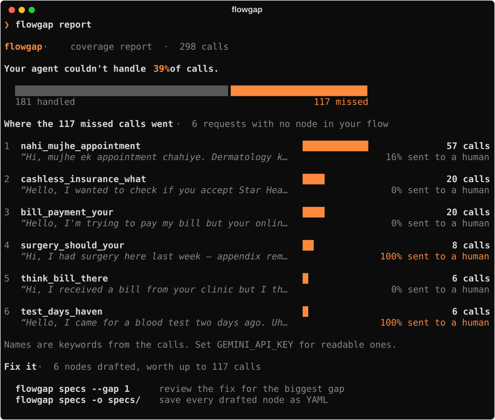
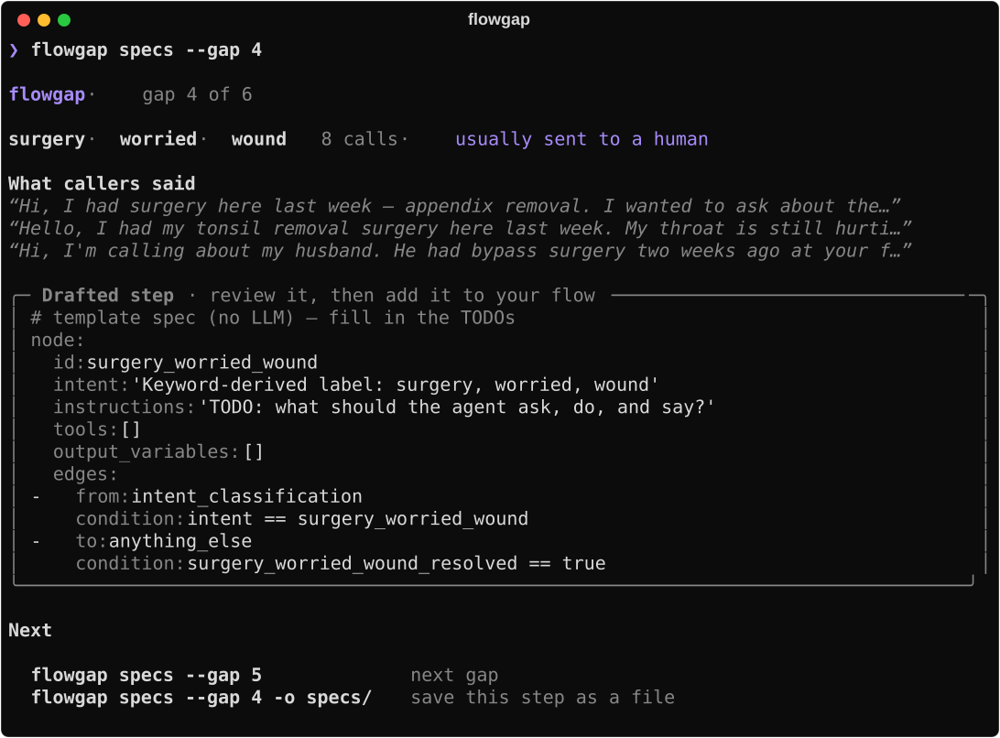
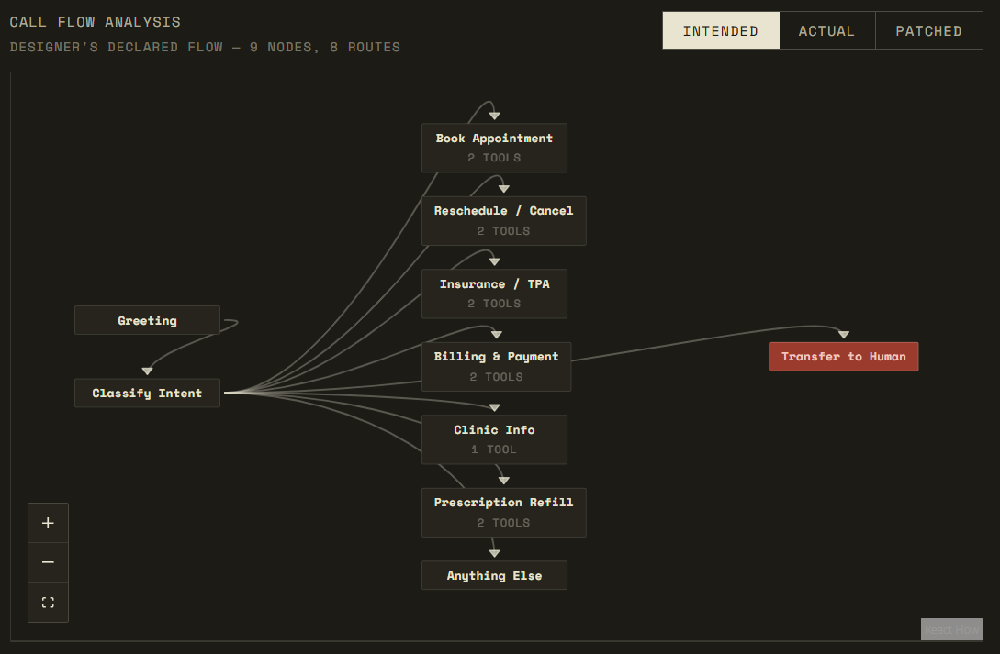
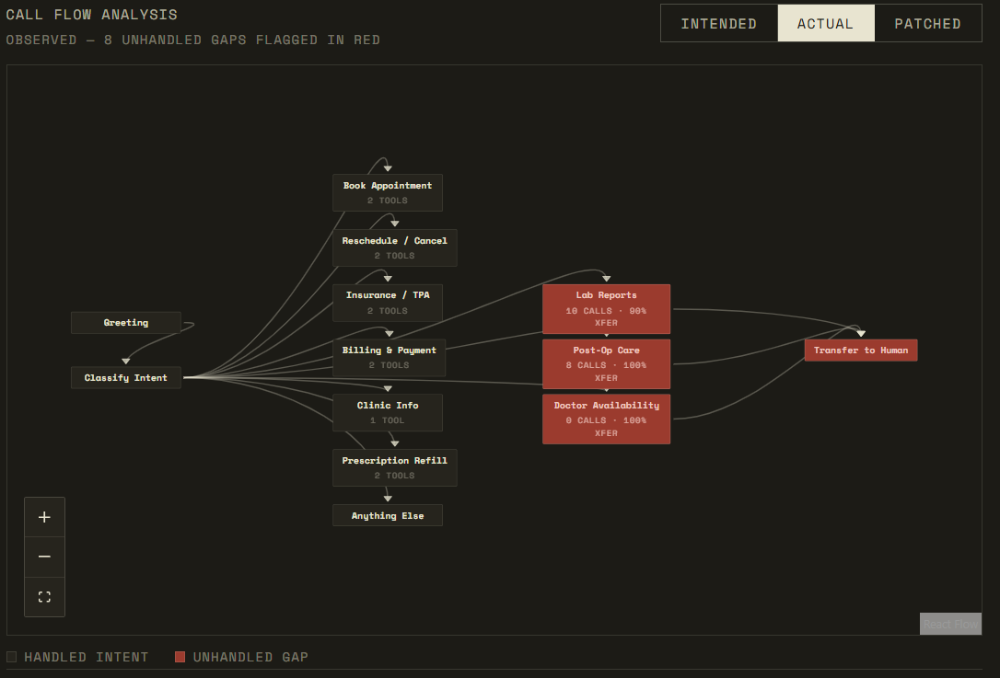
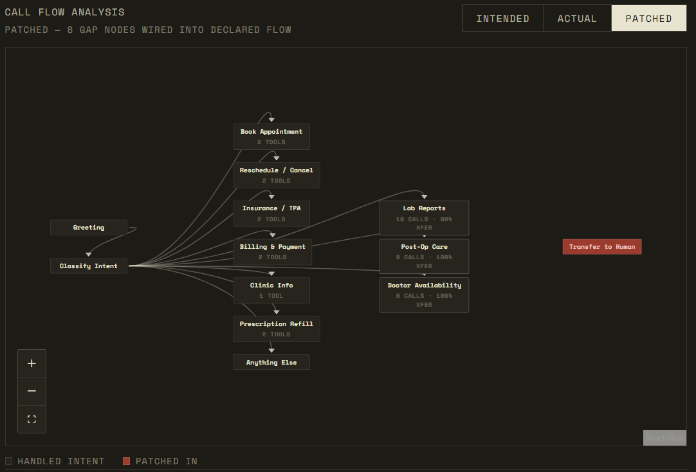

# FlowGap

**Find out what your voice agent can't handle, straight from your call logs.**

Every voice agent has requests its designers never planned for. When a caller asks for one,
the agent gives up and transfers them to a human. Nobody sees it happen, because the evidence
is spread across thousands of transcripts that nobody reads.

FlowGap reads those transcripts and tells you:

- **what share of calls** hit something your flow has no node for,
- **which requests they were**, ranked by how many calls they cost you, and
- **a drafted node for each one**, so you can close the gap.



Then pick a gap to see what callers said and the node drafted to handle it:



*Real output on the 298 demo calls, run without an API key. Gaps are named by the words that
set them apart (`surgery worried wound` is post-op care questions) and the node is a
template. With `GEMINI_API_KEY` set, gaps get written names and fully drafted nodes.*

It runs offline on logs you already have. Nothing sits in your live call path, and it never
edits your flow: you review every drafted node yourself.

## Quick start

```bash
pipx install git+https://github.com/utsav1033/flowgap
flowgap init my-agent && cd my-agent
```

Then give it two things:

1. **Your calls**: put transcripts in `transcripts/`, one file per call.
2. **Your flow**: list the nodes your agent already handles in `flow.yaml`.

```bash
flowgap analyze            # takes a minute or two → analysis.json
flowgap report             # the headline % and ranked gaps
flowgap specs --gap 1      # caller quotes + drafted node for the biggest gap
flowgap specs -o specs/    # one YAML file per gap
```

Requires Python 3.10+. The first run downloads a ~80 MB embedding model. You'll want at least
100 calls for meaningful clusters (it refuses to run on fewer than 10).

## Your inputs

**Transcripts.** Either a `.txt` file per call:

```text
CALLER: Hi, I had surgery here last week and the wound looks a bit red.
AGENT: I'm sorry to hear that. Let me connect you to our staff.
```

or a `.json` file per call with a `"transcript"` field in that same format. Only the
`CALLER:` lines are used to work out what people wanted. The `AGENT:` lines are used to
spot transfers.

**Flow.** A YAML list of what your agent already handles. `flowgap init` writes a commented
template. The most important field is `description`: write it the way callers phrase the
request, since that's what calls are matched against.

```yaml
nodes:
  - id: book_appointment
    description: "book an appointment, see a doctor, schedule a visit"
    tools: ["check_doctor_availability", "book_appointment"]
```

**API key (optional).** Add `GEMINI_API_KEY` to `.env` for readable gap names (`lab_reports`
instead of `ready test days`) and full drafted nodes. Without it, everything still runs.

## Commands

| Command | What it does |
|---|---|
| `flowgap init [dir]` | Creates `flow.yaml`, `transcripts/` and `.env` |
| `flowgap analyze [transcripts]` | Runs the pipeline and writes `analysis.json` |
| `flowgap report` | Shows the headline number and the ranked gaps (`--json` for scripts) |
| `flowgap specs` | Prints drafted nodes (`--gap N`), or writes them to a folder (`-o`) |
| `flowgap serve` | Serves the analysis as a JSON API on `:8000` |
| `flowgap eval` | Scores results against planted labels (synthetic data only) |

Useful `analyze` options: `--threshold 0.5` makes matching to your nodes looser, so fewer
gaps; `--org "Acme Dental"` sets the business name used in drafted nodes; `--no-llm` skips
Gemini. Run `flowgap <command> --help` for everything else.

## How it works

1. **Parse** the caller's side of each call: what they wanted, not what the bot said.
2. **Embed** each call locally with MiniLM, so calls that mean the same thing sit close
   together.
3. **Cluster** with UMAP → HDBSCAN. This *discovers* intents rather than sorting calls into
   a fixed list, which matters because the intent you're missing is the one you didn't
   think to list.
4. **Label** each cluster (Gemini, or a keyword fallback).
5. **Match** each cluster to your flow by meaning. Clusters that match no node are gaps.
6. **Draft** a node for each gap.

## Does it work?

Tested on **298 synthetic clinic calls**: 6 intents the flow handles, plus 3 gaps planted on
purpose so detection could be scored. Synthetic data is what makes scoring possible, but it
also means **this hasn't been proven on real production calls yet.**

| Planted gap | Calls | Found? |
|---|---|---|
| post_op_care | 13 | ✅ 100% cluster purity |
| lab_reports | 13 | ✅ 90% cluster purity |
| doctor_availability_specific | 12 | ❌ merged into normal booking |

It finds 2 of 3 real gaps (recall 0.67), but it also flags handled intents as gaps
(precision 0.25–0.33 across runs). Those runs used keyword labels only, because of API rate
limits. Those false gaps sit just below the matching threshold, so better labels or a lower
`--threshold` should cut them. The 49% headline in an earlier run vs 39% in a later rerun
shows that clustering shifts somewhat between library versions.

### Known limits

- **Narrower versions of a handled request get missed.** "An appointment with Dr. Mehta
  *specifically*" looks like ordinary booking, so it merges in. Splitting clusters a second
  time is the obvious next step.
- **Keyword labels are rough.** They work, but they're harder to read and slightly blur matching.
- **Real-world transcripts are untested.** Heavy Hindi-English code-switching is partly
  covered by the test set; other languages and messy ASR output aren't.

## Roadmap

- Importers for common voice platforms' transcript exports
- Rolling analysis: "your flow started missing X this week: N calls, all transferred"
- Splitting fine-grained sub-intents
- Publishing the dashboard frontend

If you run a voice agent and want to try it on real logs, open an issue. That's the most
useful feedback this project can get right now.

## Dashboard (preview)

The analysis was built to drive a three-view flow dashboard. The Next.js frontend isn't in
this repo yet; `flowgap serve` exposes the API it reads (`/api/analysis`, `/api/gaps`,
`/api/graph`, `/api/intended_flow`).

**Intended**: the flow as designed. **Actual**: red nodes are discovered gaps draining to a
human. **Patched**: gap nodes wired in for review.





## Running the demo / development

From a clone:

```bash
pip install -e .
flowgap analyze data/transcripts -f gen/intended_flow.yaml
flowgap eval -g data/ground_truth.json
flowgap serve -f gen/intended_flow.yaml
```

`gen/` contains the synthetic call generator (`distribution.yaml` controls the intent mix and
the planted gaps). The original scripts (`python analyzer/run.py`, `python eval/evaluate.py`,
`uvicorn api.main:app`) still work with the repo's default paths. `BUILD.md` has the original
design notes.

**Stack:** Python · Typer · sentence-transformers (MiniLM) · UMAP · HDBSCAN · FastAPI.
LLMs are used offline only, for generating test calls, labeling and drafting nodes.

MIT licensed.
